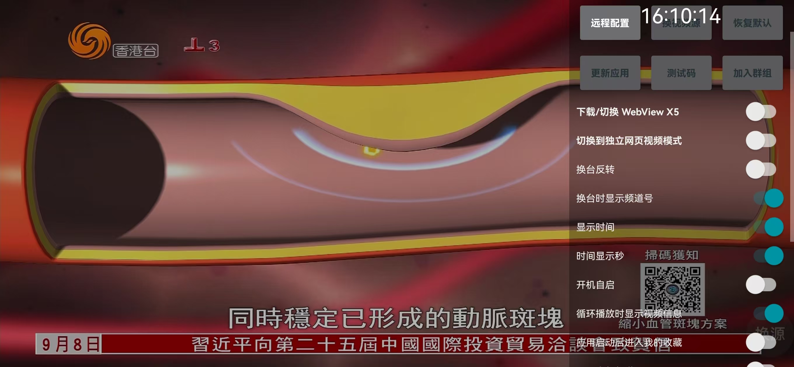
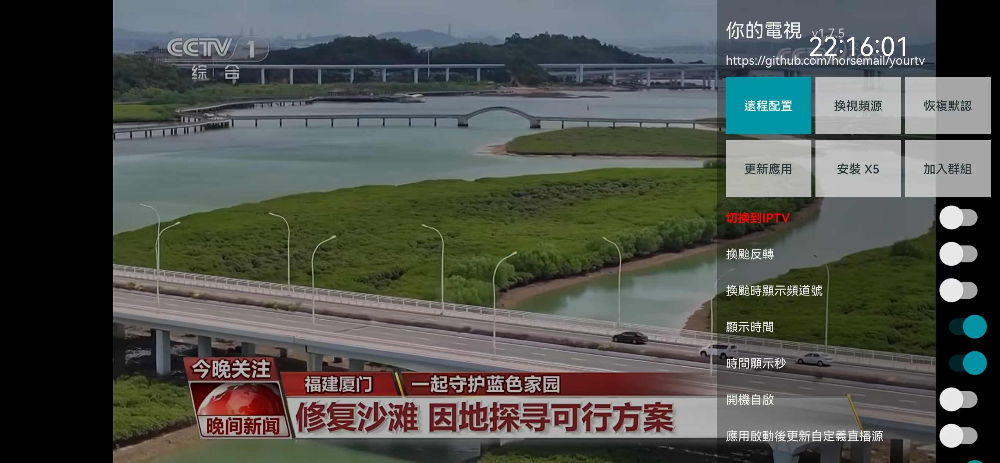

# 电视直播（LiveTV）

Android 6.0 及以上的电视、投影与盒子可用的直播频道 App，用遥控器操作，打开就能看。

本工程基于开源项目 [horsemail/yourtv](https://github.com/horsemail/yourtv)（MIT 协议）二次开发，改造点见文末。

## 功能

- **开箱可看**：内置 441 个频道（央视 / 卫视 / 地方 / 电影 / 纪录）的离线快照，装完直接有列表，断网也能播
- **自己换源**：设置页「订阅源」里用遥控器输入 m3u / txt 订阅地址，重启后仍然生效
- **一键更新**：同个对话框里点「恢复默认源」，会优先联网拉取内置订阅地址的最新列表，拉不到再用离线快照
- 遥控器方向键换台、频道分组、EPG 节目单、频道收藏（沿用上游能力）
- 已移除上游的测试码授权、个人收款入口、私有云端基础设施与在线更新检查

## 界面预览

| 画面 | 说明 |
|---|---|
|  | 应用图标：矢量绘制，蓝青渐变 + 电视播放符号 |
|  | Android TV 桌面 banner（320×180） |
|  | 播放中：左上角显示台标与频道号，按遥控器菜单键从右侧滑出面板 |
|  | 右侧半透明设置面板：顶部按钮组 + 下面一排开关（换台反转、显示时间、开机自启等） |

> 截图取自上游原始版本，整体布局与本版本一致。本版本已去掉「测试码 / 赞赏 / 加入群组 / 更新应用」，
> 原「测试码」按钮改成了「订阅源」。

## 构建

本项目不在本地打包，统一走 GitHub Actions：

1. 把仓库推送到你自己的 GitHub（`main` 分支）
2. Actions 会自动执行 `testDebugUnitTest` 与 `assembleDebug`
3. 构建完成后在 Actions 页面下载构件 `livetv-debug-apk`，里面是 `livetv_v1.0.0.apk`

如需本地构建（需要 JDK 17 + Android SDK 35）：

```
./gradlew testDebugUnitTest assembleDebug
```

产物路径：`app/build/outputs/apk/debug/`

## 安装到电视

- U 盘：把 apk 拷进 U 盘，插到电视上，用电视自带的文件管理打开安装（首次需在设置里允许安装未知来源应用）
- 或局域网：电视开启开发者模式后用 `adb install livetv_v1.0.0.apk`

## 频道源怎么维护

内置地址在 `app/src/main/java/com/livetv/tv/BuiltinSource.kt`，按顺序尝试：

1. `https://cdn.jsdelivr.net/gh/vbskycn/iptv@master/tv/iptv4.m3u` — 主地址，国内可直连
2. `https://fastly.jsdelivr.net/gh/vbskycn/iptv@master/tv/iptv4.m3u` — 备用节点
3. `https://raw.githubusercontent.com/vbskycn/iptv/master/tv/iptv4.m3u` — 兜底，部分网络不可达

`app/src/main/res/raw/channels.txt` 是同一份源的离线快照（441 台），三个地址全失败时使用。
更新快照：下载上面的 m3u，剔除 `group-title` 为「更新时间 / 支持作者 / 公告 / 广告」的条目，
以 UTF-8 无 BOM 覆盖该文件。

> 旧脚本 `tools/gen-default-channels.ps1` 基于 iptv-org，其流地址多为海外 IP，国内电视基本播不动，已不推荐。

## 播不出来怎么办

点台后一直转圈，通常不是程序坏了。先看提示属于哪一类：

| 表现 | 原因 | 怎么办 |
|---|---|---|
| 转圈约 20 秒后提示「长时间没有画面，可能是源太慢或已失效」 | 该源带宽不足或已下线（实测有单分片 5 MB、要下 52 秒的台） | 换台；或填自己的订阅源 |
| 提示「视频编码当前设备不支持」 | 该台是 H.265 / MPEG-2 等编码，当前设备解不了 | 换台，这类台本机无解 |
| 提示「播放错误」并反复出现 | 源地址已失效 | 换台；或在「订阅源」里点「恢复默认源」拉新列表 |
| 只有个别台一直不行 | 第三方源的普遍现象 | 优先看央视、卫视等大台更稳 |

内置源的实测可用性、诊断顺序，以及「为什么不能把点台播不出来都当成 bug」，见 [docs/pitfalls.md](docs/pitfalls.md)。

## 免责声明

- 本项目不提供、不存储、不分发任何音视频内容，只提供播放能力与一份第三方公开收集的频道列表地址。
- 频道流的可用性与合法性由对应源提供方决定，请自行确认你所在地区使用的合规性。
- 上游项目的测试码、云端账号体系与作者私有服务均已停用，与本项目无关。

## 许可

沿用上游 MIT 协议，见 `LICENSE`。原始版权归 horsemail/yourtv 作者所有。
